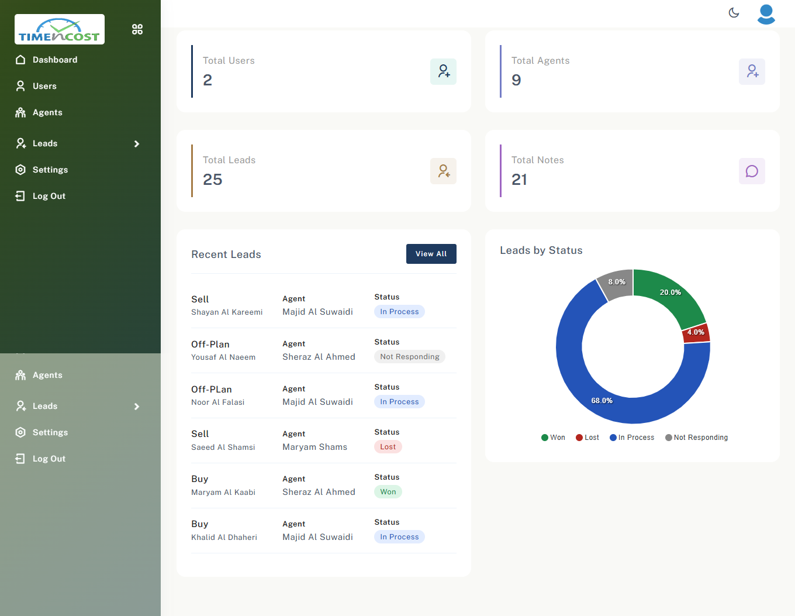
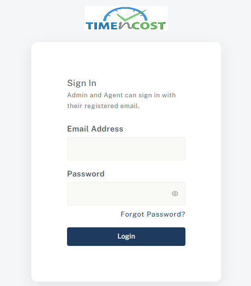
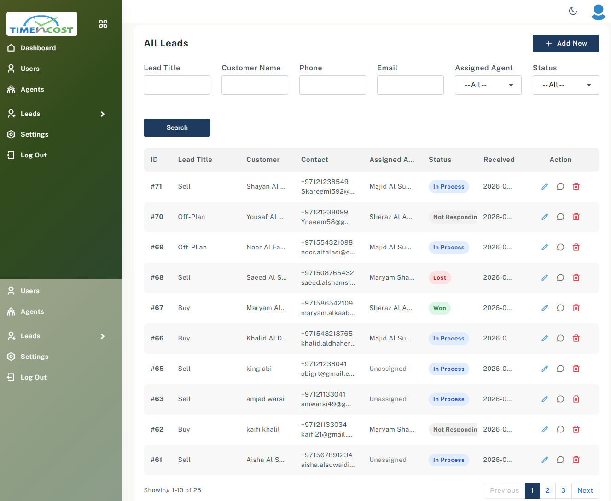
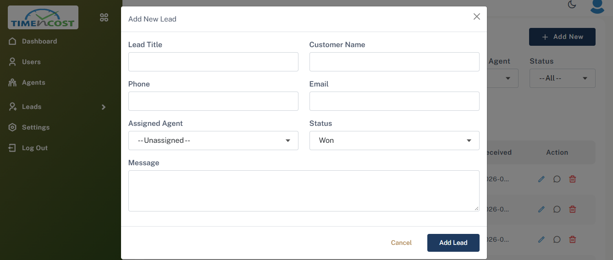
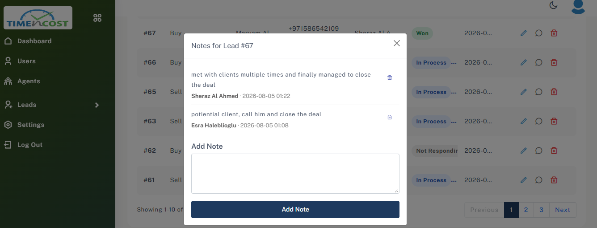
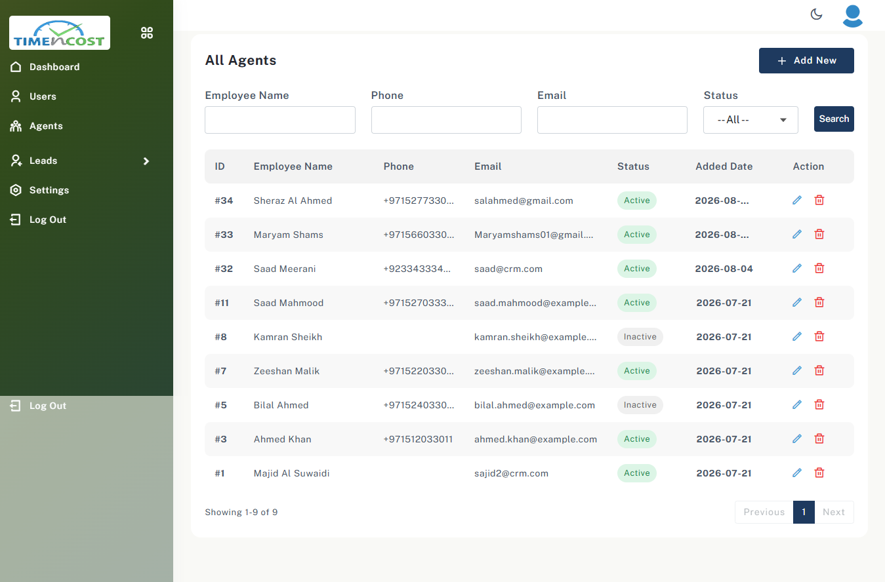
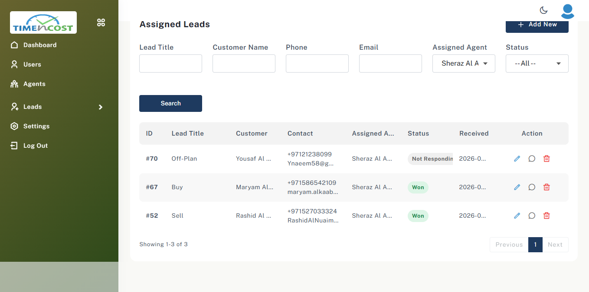
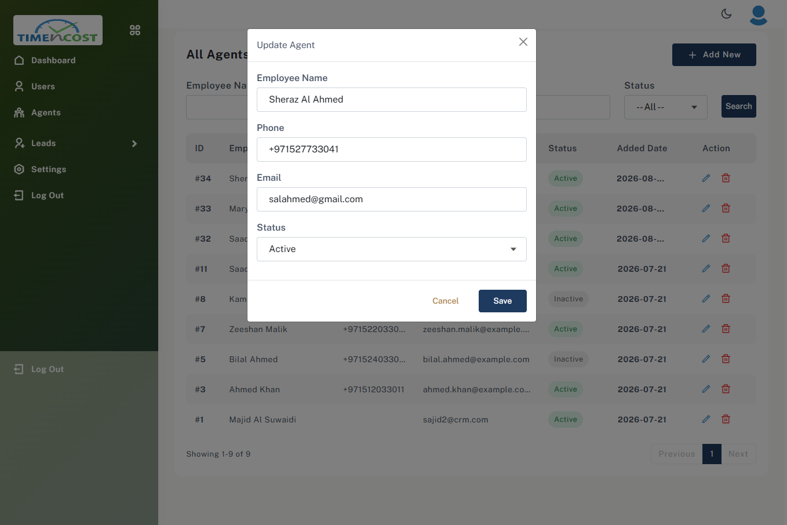

# LaraCRM

A simple lead-management CRM built with Laravel. Admins collect sales leads and assign them to sales agents; agents work their own leads, update the status and keep notes on every follow-up.

**Live demo:** [crm.timencost.com](https://crm.timencost.com)



## Features

**Admin panel**
- Dashboard with totals (users, agents, leads, notes), the latest leads and a leads-by-status chart
- Manage admin users and sales agents (add, edit, activate/deactivate, delete)
- Leads: add, edit, delete, assign or reassign to an agent
- All / Assigned / Unassigned lead views with search filters and pagination
- Notes on every lead, shared with the assigned agent
- Every status change and reassignment is recorded in an activity log

**Agent panel**
- "My Leads": only the leads assigned to the signed-in agent
- New, untouched leads are highlighted
- Update a lead's status (In Process, Not Responding, Won, Lost)
- Read and add notes

**Accounts and security**
- One login page for both roles, using separate auth guards (`admin`, `agent`)
- Inactive accounts cannot sign in
- Password reset by email with one-time, hashed tokens that expire after 1 hour
- Login and reset forms are rate-limited
- Agents can only reach leads assigned to them (enforced on the server)

## Screenshots

| Login | Dashboard |
| --- | --- |
|  |  |

| All Leads | Add / Edit Lead |
| --- | --- |
|  |  |

| Lead Notes | Agents |
| --- | --- |
|  |  |

| Agent: My Leads | Agent: Update Status |
| --- | --- |
|  |  |

## Tech stack

- **Backend:** Laravel 13, PHP 8.3+
- **Database:** MySQL / MariaDB (SQLite works for local development)
- **Frontend:** Blade, Bootstrap 5, jQuery (AJAX tables and modals), ApexCharts
- **Testing:** PHPUnit feature tests

## Getting started

Requirements: PHP 8.3+, Composer, and MySQL/MariaDB (or SQLite).

```bash
git clone https://github.com/sajid-munir/laracrm.git
cd laracrm
composer install
cp .env.example .env
php artisan key:generate
```

Set your database in `.env` (`DB_CONNECTION`, `DB_DATABASE`, `DB_USERNAME`, `DB_PASSWORD`), then:

```bash
php artisan migrate --seed
php artisan serve
```

Open http://127.0.0.1:8000 and sign in with the seeded admin account:

- **Email:** `admin@example.com`
- **Password:** `password`

Change this password straight away on any server that is reachable from the internet.

### Email (password reset)

Reset links are sent by email. For local development, the default `MAIL_MAILER=log` writes emails to `storage/logs/laravel.log`. In production, set an SMTP account:

```env
MAIL_MAILER=smtp
MAIL_SCHEME=smtps
MAIL_HOST=mail.example.com
MAIL_PORT=465
MAIL_USERNAME=crm@example.com
MAIL_PASSWORD=your-password
MAIL_FROM_ADDRESS="crm@example.com"
```

## Running tests

```bash
php artisan test
```

## Project structure

| Path | What it holds |
| --- | --- |
| `app/Http/Controllers/Admin` | Dashboard, users, agents and leads for admins |
| `app/Http/Controllers/Agent` | "My Leads" and status updates for agents |
| `app/Http/Controllers/Auth` | Login, logout and password reset for both roles |
| `app/Models` | `User` (admin), `SalesAgent`, `Lead`, `LeadNote`, `LeadActivityLog`, `PasswordReset` |
| `resources/views` | Blade pages for the admin panel, agent panel and auth screens |
| `tests/Feature` | Feature tests for every section |

## License

Released under the [MIT License](LICENSE).
